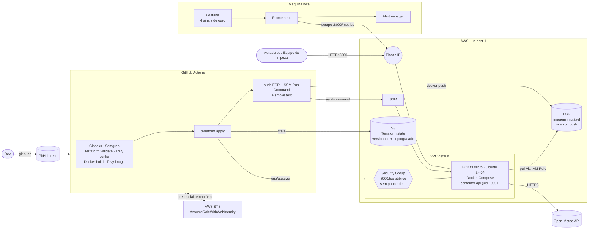

# Arquitetura — Boca de Lobo (MVP)

## 1. Diagrama

**Fluxo:** cada push executa os scans. Na `master`, se todos passarem, o job `infra` assume a IAM Role via OIDC (sem chave de longa duração), aplica o Terraform (state no S3) e o job `deploy` publica a imagem no ECR e manda o EC2 executar `docker compose pull && up -d` via SSM Run Command. Nenhuma porta administrativa é aberta.

> O OIDC provider, a IAM Role de deploy e o bucket do state são mantidos em um repositório de infraestrutura base separado (requisitos em [aws-role.md](aws-role.md)). Este repositório cria apenas os recursos da aplicação: EC2, EIP, Security Group, ECR e a role/instance profile do EC2.

## 2. Controles de segurança

| Requisito | Implementação |
|---|---|
| Usuário não-root | `USER 10001` no Dockerfile; `user: 10001` + `cap_drop: ALL` + `no-new-privileges` + `read_only` no compose; pipeline verifica `id -u != 0` |
| Sem segredo na imagem | `.dockerignore` exclui `.env`/tfvars; Trivy `--scanners secret`; pull do ECR via IAM Role da instância |
| State e tfvars fora do repo | Backend S3 (bucket por conta, versionado, SSE, TLS-only, lock nativo); `.gitignore` bloqueia `*.tfstate`/`*.tfvars`; variáveis vêm de GitHub Secrets/Variables (`TF_VAR_*`) |
| Porta admin nunca 0.0.0.0/0 | Sem porta 22 por padrão (acesso via SSM); `admin_cidrs` opcional com `validation` que rejeita `0.0.0.0/0` e `::/0` |
| Segredos no GitHub Secrets | Apenas `AWS_ROLE_ARN`, `TF_STATE_BUCKET` e opcional `TF_VAR_admin_cidrs`; sem access keys (OIDC) |
| Menor privilégio | Role do GitHub restrita ao repositório + environment `production`; policies escopadas por nome/tag/região |
| Hardening do host | IMDSv2 obrigatório, EBS criptografado, `unattended-upgrades` |

## 3. Modelo de responsabilidade compartilhada

| Camada | AWS | Nós (time CitizenTech) |
|---|---|---|
| Data centers, hardware, rede física | ✅ | |
| Hipervisor (Nitro) e isolamento entre clientes | ✅ | |
| Serviços gerenciados (S3, ECR, SSM, STS, IAM) — disponibilidade e segurança da plataforma | ✅ | |
| Criptografia em repouso do S3/EBS/ECR | fornece o recurso | habilitar e configurar (feito via Terraform) |
| Sistema operacional do EC2 (patches, hardening) | | ✅ (`unattended-upgrades`, AMI atualizada) |
| Docker, imagem e dependências da aplicação | | ✅ (Trivy, base slim, não-root) |
| Security Group e exposição de rede | | ✅ |
| IAM (roles, OIDC, menor privilégio) | | ✅ |
| Segredos e credenciais | | ✅ (GitHub Secrets, OIDC, sem chaves estáticas) |
| Código da aplicação (SAST) | | ✅ (Semgrep) |
| Dados e logs (LGPD, retenção) | | ✅ |
| Monitoramento e resposta a incidentes | fornece CloudWatch/SSM | ✅ (Prometheus/Grafana/Alertmanager) |

## 4. LGPD — onde ficam os dados pessoais

| Dado | É pessoal? | Onde fica | Retenção / controle |
|---|---|---|---|
| Coordenadas e IDs das bocas de lobo | Não (infraestrutura pública) | Código da aplicação | — |
| Dados de chuva (Open-Meteo) | Não | Memória do processo (não persistido) | — |
| **IP do cliente nos logs de acesso do uvicorn** | **Sim** (dado pessoal indireto) | Logs do Docker (`json-file`) no volume EBS criptografado do EC2, em **us-east-1** (EUA) | Rotação automática: 3 arquivos × 10 MB; acesso só via SSM pela equipe |
| Métricas Prometheus | Não (agregadas, sem IP/usuário) | Máquina local do time, retenção 7 dias | — |
| Terraform state | Não contém dado pessoal (contém metadados de infra) | S3 criptografado, privado | Versionado |

Considerações:
- **Transferência internacional (art. 33):** os logs com IP ficam nos EUA. Para produção, recomenda-se migrar para `sa-east-1` (São Paulo) ou garantir cláusulas contratuais (a AWS oferece DPA com cláusulas padrão).
- **Minimização (art. 6º, III):** o MVP não coleta nome, telefone ou localização de moradores.
- **Evolução prevista:** o cadastro de moradores para alertas de rota segura (nome, telefone, endereço = dados pessoais; localização residencial pode revelar padrões sensíveis) deverá ficar em banco gerenciado criptografado (ex.: RDS/DynamoDB com KMS) em `sa-east-1`, com base legal de consentimento ou execução de política pública (art. 7º, III), política de retenção, anonimização em métricas e canal para direitos do titular (art. 18).

## 5. Estimativa de custo (us-east-1, sob demanda, 730 h/mês)

| Recurso | Preço de referência | Custo/mês |
|---|---|---|
| EC2 t3.micro | US$ 0,0104/h | ~US$ 7,59 |
| EBS gp3 8 GB | US$ 0,08/GB-mês | ~US$ 0,64 |
| IPv4 público (Elastic IP associado) | US$ 0,005/h | ~US$ 3,65 |
| ECR (≤ 5 imagens × ~60 MB comprimido) | US$ 0,10/GB-mês | < US$ 0,05 |
| S3 (Terraform state, poucos KB) | US$ 0,023/GB-mês + requests | < US$ 0,01 |
| Transferência de saída (MVP, < 100 GB) | 100 GB/mês gratuitos | US$ 0 |
| SSM Run Command, IAM, OIDC/STS | gratuito | US$ 0 |
| GitHub Actions | gratuito em repo público (2.000 min/mês em privado) | US$ 0 |
| Prometheus/Grafana/Alertmanager | executados localmente | US$ 0 |
| **Total** | | **≈ US$ 12/mês (~R$ 70)** |

Contas elegíveis ao Free Tier/créditos podem zerar o EC2/EBS. Para economizar quando não estiver em uso: `terraform destroy` (ou parar a instância — o EIP continua cobrando enquanto alocado).
