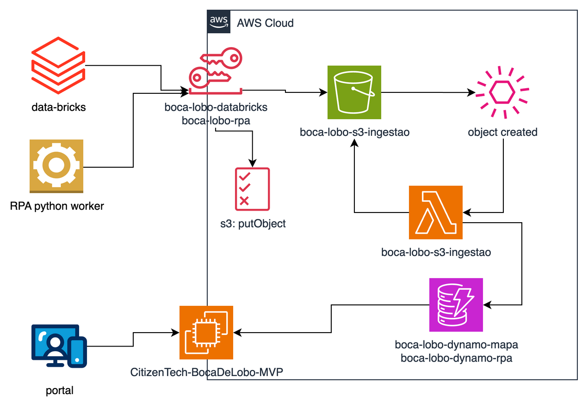

# Ingestão de dados: Databricks e RPA → S3 → Lambda → DynamoDB → API



Dois fluxos externos alimentam o MVP. Os dois seguem o mesmo caminho na AWS. Cada um tem a sua pasta no bucket,
o seu usuário IAM e a sua tabela no DynamoDB:

| Fluxo | Quem envia | Usuário IAM | Pasta no bucket | Tabela DynamoDB (item) | Rota da API | Onde aparece no portal |
|---|---|---|---|---|---|---|
| **databricks** | Notebook `03_ouro.py` (camada Ouro) | `boca-lobo-databricks` | `databricks/` | `boca-lobo-dynamo-mapa` (`mapa_atual`) | `/api/v1/mapa` | aba *Onde não passar* |
| **rpa** | `RPA python worker` (bot de limpeza) | `boca-lobo-rpa` | `rpa/` | `boca-lobo-dynamo-rpa` (`rpa_atual`) | `/api/v1/rpa` | aba *Limpeza (RPA)* |

```
s3://boca-lobo-s3-ingestao/
├── databricks/
│   ├── entrada/      ← o Databricks grava aqui
│   ├── processado/   ← a Lambda move os aceitos (90 dias)
│   └── quarentena/   ← a Lambda move os recusados, com o motivo (30 dias)
└── rpa/
    ├── entrada/      ← o bot RPA grava aqui
    ├── processado/
    └── quarentena/
```

**Regra comum aos dois fluxos:** quem envia só grava em `<fluxo>/entrada/`. A Lambda é quem tira o arquivo de
`entrada/` e o move para `processado/` ou `quarentena/`. Ela nunca grava em `entrada/`, e só `<fluxo>/entrada/*.json`
dispara o evento. Assim, os arquivos que ela mesma move não são processados de novo.

---

## Fluxo do RPA

O **bot RPA** (`RPA python worker`, no diagrama) roda todo dia às 06:00. Ele consulta a previsão de chuva (Open-Meteo),
decide o nível de risco, lê as inspeções do robô nas bocas de lobo, calcula a prioridade de cada uma e distribui as
ordens de serviço entre as equipes de limpeza. Ao final de cada execução, ele publica o resultado na AWS para a API e
o portal.

```
RPA python worker
   │  1. PutObject (HTTPS) com o usuário boca-lobo-rpa
   ▼
s3://boca-lobo-s3-ingestao/rpa/entrada/bocaLobo_<AAAAMMDD>_<HHMMSS>.json
   │  2. evento "object created" (filtro rpa/entrada/*.json)
   ▼
Lambda boca-lobo-lambda-ingestor
   │  3. identifica o fluxo pela pasta (rpa/) e valida o arquivo
   ├──► inválido → rpa/quarentena/<arquivo>   (motivo nos metadados; a API segue com a última versão boa)
   │
   │  4. válido → grava o item "rpa_atual" (escrita condicional pela data da execução)
   ▼
DynamoDB boca-lobo-dynamo-rpa      e o arquivo vai para rpa/processado/<arquivo>
   │  5. a API no EC2 lê a tabela a cada 60 s (cache em memória)
   ▼
CitizenTech-BocaDeLobo-MVP  →  GET /api/v1/rpa  e  /api/v1/rpa/resumo
   │  6. HTTPS (CORS só para o portal, só GET)
   ▼
portal → aba "Limpeza (RPA)": nível da chuva, contadores e a lista de bocas de lobo para limpar no mapa
```

### 1. Envio pelo bot

| Item | Valor |
|---|---|
| Destino | `s3://boca-lobo-s3-ingestao/rpa/entrada/<nome>.json` (um arquivo novo por execução, terminando em `.json`) |
| Identidade | Usuário IAM `boca-lobo-rpa`, que só pode fazer `s3:PutObject` em `rpa/entrada/*`. Não lê, não lista e não apaga nada |
| Credencial | Access key gerada pela CLI (`aws iam create-access-key --user-name boca-lobo-rpa`) e guardada como segredo do bot (`RPA_AWS_ACCESS_KEY_ID` / `RPA_AWS_SECRET_ACCESS_KEY`). Nunca vai para o código nem para o Terraform state |
| Transporte | Só HTTPS: a política do bucket nega qualquer requisição sem TLS |
| `Content-Type` | `application/json` |

### 2. Conteúdo do arquivo

O JSON tem `execucao` e `ordens_servico` na raiz. Outros campos que o bot envia (`alertas`, `historico_execucoes`,
`bueiros_sem_inspecao`) são aceitos, mas **não seguem** para o DynamoDB.

**`execucao`**: resumo da execução

| Campo | Exemplo | Significado |
|---|---|---|
| `id` | `EX20261118T142640` | Identificador da execução (obrigatório) |
| `inicio` / `fim` | `2026-11-18T14:26:40` | Data e hora no horário de São Paulo (`inicio` é obrigatório) |
| `status` | `CONCLUIDO`, `CONCLUIDO_COM_PENDENCIAS`, `SEM_ACAO`, `FALHA_PREVISAO`, `FALHA_DADOS`, `FALHA` | Status final (obrigatório) |
| `nivel` | `NORMAL`, `ATENCAO`, `ALERTA` | Nível da chuva. Ausente quando a previsão falhou |
| `justificativa` | `75.0 mm em 24h >= 50 mm (alerta)` | Por que esse nível foi escolhido |
| `chuva_24h_mm`, `pico_mm_h`, `probabilidade_max_pct` | `75.0`, `22.5`, `90.0` | Chuva prevista em 24 h, pico por hora e probabilidade |
| `fonte_previsao` | `open-meteo`, `cache (2.0h atrás)`, `simulacao` | De onde veio a previsão |
| `linhas_lidas`, `inspecoes_validas`, `rejeitados`, `duplicados`, `arquivos_invalidos` | `44`, `23`, `7`, `2`, `1` | Inspeções do robô lidas e o resultado da validação |
| `ordens_geradas`, `excedentes` | `19`, `4` | Ordens de serviço criadas e quantas ficaram sem equipe |
| `alertas_enviados`, `alertas_ignorados`, `falhas_envio` | `0`, `17`, `0` | Alertas enviados, já enviados antes (idempotência) e falhas |
| `codigo_saida` | `0` | Código de saída do bot |

**`ordens_servico`**: bocas de lobo para limpar, da mais urgente para a menos urgente

| Campo | Exemplo | Significado |
|---|---|---|
| `ordem` | `1` | Posição na fila de limpeza |
| `id_bueiro` | `BL-001` | Código do bueiro (obrigatório, único no arquivo) |
| `endereco`, `area_id`, `area`, `tipo` | `Rua das Garças, 664`, `AR-01`, `Jardim Pantanal`, `boca de lobo` | Endereço, área (bairro) e tipo |
| `lat`, `lon` | `-23.4978`, `-46.4306` | Coordenadas (obrigatórias, dentro da Região Metropolitana de SP) |
| `nivel_obstrucao`, `tipo_residuo` | `92.0`, `folhas` | % de obstrução (0 a 100) e tipo de lixo |
| `score`, `prioridade` | `94.0`, `CRITICA` | Nota de 0 a 100 e prioridade (`CRITICA`, `ALTA` ou `MEDIA`) |
| `nivel_risco_area` | `3` | Risco de alagamento da área (1 a 3) |
| `equipe_id`, `status` | `EQ-01`, `ABERTA` | Equipe responsável e status (`ABERTA` ou `AGUARDANDO_REFORCO`, este sem equipe) |
| `reinspecionar`, `data_inspecao`, `observacao` | `false`, `2026-11-16T09:05`, `""` | Se precisa de nova inspeção do robô, data da inspeção e observação |

Uma execução sem ação (`SEM_ACAO`) ou com falha controlada chega com `ordens_servico: []`. Isso é válido: o portal
mostra o status da execução e avisa que não há bocas de lobo para limpar.

### 3. Validação na Lambda

A Lambda (`lambda/ingestor/src/handler.py`, função `validar_rpa`) recusa o arquivo inteiro se encontrar:

- JSON inválido, raiz que não é objeto, ou arquivo com mais de 5 MB;
- `execucao` ou `ordens_servico` ausentes, ou com tipo errado;
- `execucao.id`, `inicio` ou `status` vazios; `inicio`/`fim` que não são datas; `nivel` fora de `NORMAL`/`ATENCAO`/`ALERTA`;
- contadores ou valores de chuva negativos ou que não são números;
- ordem sem `id_bueiro`, com `lat`/`lon` fora de São Paulo, `nivel_obstrucao` ou `score` fora de 0 a 100;
- `prioridade` fora de `CRITICA`/`ALTA`/`MEDIA`, `status` fora de `ABERTA`/`AGUARDANDO_REFORCO`, `reinspecionar` que não é verdadeiro/falso;
- `id_bueiro` repetido.

O arquivo recusado vai para `rpa/quarentena/` com o motivo no metadado `motivo` e no log
`/aws/lambda/boca-lobo-lambda-ingestor` (evento `ingestao_rejeitada`). O que estava publicado continua no ar.

### 4. Gravação no DynamoDB

Tabela `boca-lobo-dynamo-rpa` (provisionada, 5 RCU / 5 WCU, criptografada), com um único item:

| Atributo | Conteúdo |
|---|---|
| `pk` | `rpa_atual` |
| `execucao_id`, `inicio`, `status`, `nivel`, `total_ordens` | Resumo para consulta rápida |
| `inicio_utc` | `inicio` convertido para UTC, usado na escrita condicional |
| `dados_gz` | `{"execucao": …, "ordens_servico": […]}` compactado com gzip (~2 KB para 19 ordens) |
| `arquivo_origem`, `processado_em` | Rastreabilidade: de qual arquivo veio e quando foi publicado |

- **Minimização (LGPD):** só a execução e as ordens de serviço são gravadas, e apenas com os campos listados acima.
  Os alertas (IDs de moradores e contatos mascarados) e o texto livre `mensagem` do bot ficam fora da tabela.
- **Escrita condicional:** o item só é substituído se a execução recebida for igual ou mais nova que a publicada
  (`inicio_utc`). Um arquivo antigo reenviado vai para `rpa/processado/` com `status = ignorado_mais_antigo` e
  não sobrescreve nada.

### 5. API

A API no EC2 lê `rpa_atual` a cada 60 s, com cache em memória independente do mapa: se a leitura do RPA falhar,
ela continua servindo a última versão boa, e o mapa não é afetado.

| Rota | Resposta |
|---|---|
| `GET /api/v1/rpa` | `execucao`, `ordens_servico` e `publicado_em` |
| `GET /api/v1/rpa/resumo` | Nível e chuva da execução, total de ordens, contagem por prioridade e por status, quantas precisam de reinspeção |
| `GET /health` | `rpa_carregado: true/false` |
| `GET /metrics` | `rpa_execucao_inicio_timestamp_seconds`, `rpa_total_ordens`, `rpa_leitura_falhas_total` |

Enquanto nenhum resultado foi publicado, as rotas do RPA respondem `503`.

### 6. Portal

A aba **Limpeza (RPA)** do portal mostra:

- o nível da chuva, a chuva prevista, o pico, a probabilidade, a fonte da previsão e o status da execução;
- as bocas de lobo para limpar, quantas aguardam reforço e os alertas enviados;
- o resultado da validação das inspeções do robô;
- a lista em ordem de urgência, com filtro por prioridade e marcações de *aguardando reforço* e *reinspecionar*;
- uma camada própria no mapa, com cor por prioridade.

Se a API do RPA estiver fora, só essa aba avisa. A aba *Onde não passar* continua funcionando.

### Como conferir uma execução

```bash
# 1. o arquivo saiu de entrada/? (processado = aceito, quarentena = recusado)
aws s3 ls s3://boca-lobo-s3-ingestao/rpa/ --recursive

# 2. se foi para a quarentena, o motivo
aws s3api head-object --bucket boca-lobo-s3-ingestao --key rpa/quarentena/<arquivo>.json --query Metadata

# 3. o que está publicado no DynamoDB
aws dynamodb get-item --table-name boca-lobo-dynamo-rpa --key '{"pk":{"S":"rpa_atual"}}' \
  --query 'Item.[execucao_id.S,status.S,nivel.S,total_ordens.N]' --output text

# 4. o que a API está servindo (até 60 s depois)
curl -s https://98-86-45-71.sslip.io/api/v1/rpa/resumo
```

| Sintoma | Causa provável |
|---|---|
| `AccessDenied` (403) no envio do bot | Chave gravada fora de `rpa/entrada/`, ou credencial de outro usuário |
| Arquivo parado em `rpa/entrada/` | Nome sem `.json`, ou gravado antes de a notificação existir (só arquivos novos disparam a Lambda): envie de novo |
| Arquivo em `rpa/quarentena/` | Conteúdo recusado pela validação: veja o metadado `motivo` |
| `processado/` com `status = ignorado_mais_antigo` | Já existe uma execução mais nova publicada |
| `/api/v1/rpa` com dados antigos | Cache de 60 s, ou a leitura do DynamoDB falhou (veja `rpa_leitura_falhas_total` em `/metrics`) |

---

## Fluxo do Databricks

O notebook `03_ouro.py` gera o `mapa_cidadao.json` a partir da view `ouro_vw_mapa_cidadao`, que não tem dados pessoais.
Ele envia esse arquivo para `s3://boca-lobo-s3-ingestao/databricks/entrada/mapa_cidadao_<AAAAMMDDTHHMMSSZ>.json` com o
usuário `boca-lobo-databricks`, cuja credencial fica no secret scope `gs` do Databricks.

A Lambda valida:

- `gerado_em` (data) e `pontos` (lista não vazia);
- em cada ponto: `id_bueiro`, `latitude`, `longitude`, `logradouro`, `nivel_alerta` e `recomendacao`;
- `nivel_alerta` em `EVITE A AREA`, `ATENCAO` ou `NORMAL`;
- coordenadas dentro de São Paulo e IDs sem repetição.

Se o arquivo for válido, a Lambda grava o item `mapa_atual` em `boca-lobo-dynamo-mapa` (pontos em gzip, escrita
condicional por `gerado_em_utc`) e move o arquivo para `databricks/processado/`. Se não for, ele vai para
`databricks/quarentena/`. A API serve o resultado em `/api/v1/mapa` e `/api/v1/mapa/resumo`.

Plano B, quando o Databricks não consegue enviar direto: baixe o JSON do Volume e rode
`scripts/publicar_mapa.sh caminho/mapa_cidadao.json`. O script envia para `databricks/entrada/` e espera a resposta da
Lambda.
