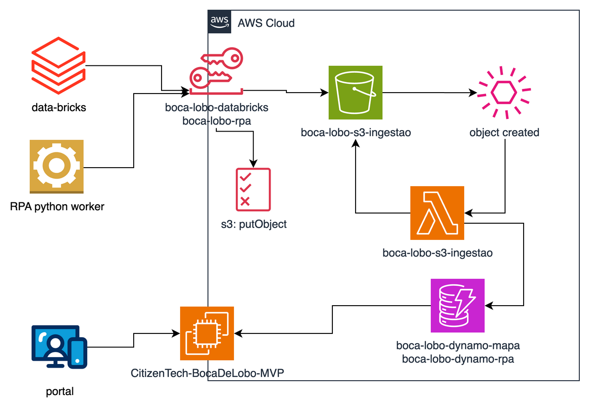

# 🌊 CitizenTech - Projeto Boca de Lobo (MVP)

> **Global Solution 2026.2 - Secure DevOps Tools & Cloud Computing**

## 🎯 Objetivo do Projeto
O **Boca de Lobo** é um MVP de engenharia de software focado em segurança e emergências urbanas (enchentes). Antes de cada temporal, o sistema cruza o status de obstrução de bueiros/sarjetas com previsões meteorológicas para disparar ações preventivas para a equipe de limpeza e alertas de rota segura para moradores de regiões de risco.

## 📋 Ficha do produto
| Campo | Resposta |
|---|---|
| Nome do produto | Boca de Lobo |
| Cidadão e território | Morador de bairro que alaga todo verão, principalmente em áreas baixas e periféricas de São Paulo (piloto na zona leste) |
| Problema, em uma frase | Bueiro entupido + chuva forte = rua alagada, carro perdido e casa invadida, e ninguém avisa antes |
| Proposta de valor | Saber antes da chuva quais bueiros estão entupidos em área de risco: a equipe de limpeza recebe a rota priorizada, e o morador sabe onde não passar e o que fazer |
| Arquitetura: componentes | Robô de inspeção (Maker Lab) · YOLO + graduador de obstrução (Visão) · assistente com RAG e agente (GenAI) · pipeline Airflow → Databricks Bronze/Prata/Ouro (Big Data) · bot de alertas (RPA) · deploy na AWS com observabilidade (DevOps) · modelo de negócio (BI) · mapa público do cidadão (MVP) |
| Fontes de dados | Open-Meteo (previsão de chuva) · Cemaden (pluviômetros) · GeoSampa (áreas de risco) · SP156 (pedidos de drenagem) · inspeções do robô (simuladas) · 22 fontes oficiais da Defesa Civil, Ministério da Saúde e Prefeitura (base do assistente) |
| Modelos de IA utilizados | Visão: YOLOv8n (`yolov8n-bocadelobo-v2`) + graduador sobre CLIP ViT-B/32 e DINOv2 ViT-S/14 · GenAI: LLM `gemma3:4b` + embeddings `bge-m3`, locais (Ollama) · Robô: classificador embarcado livre/atenção/crítico (ultrassom) |
| URL do MVP e repositório | MVP: [Boca de Lobo · Onde não passar hoje](https://felipevoidela.github.io/GS2-2026-Big-Data-Architecture/) · Repositório: [FelipeVoidela/GS2-2026-Big-Data-Architecture](https://github.com/FelipeVoidela/GS2-2026-Big-Data-Architecture) |
| Indicadores de impacto | Pontos críticos em área de risco com chuva prevista · moradias e pessoas nessas áreas · tempo de espera no SP156. No export de 08/11/2026: 259 bocas de lobo no mapa, 12 em “Evite a área”, 905 moradias e 2.525 pessoas em área de risco com bueiro crítico |
| ODS conectados | 11 (cidades resilientes, meta 11.5) · 13 (adaptação ao clima, meta 13.1) · 3 (saúde, doenças de veiculação hídrica, meta 3.3) |

## 🔗 Acesse a aplicação
| Acesso | Link | O que é |
|---|---|---|
| Portal (MVP) | [felipevoidela.github.io/GS2-2026-Big-Data-Architecture](https://felipevoidela.github.io/GS2-2026-Big-Data-Architecture/) | Frontend que consome a API: aba *Onde não passar* (mapa do cidadão) e aba *Limpeza (RPA)* |
| Swagger (OpenAPI) | [98-86-45-71.sslip.io/docs](https://98-86-45-71.sslip.io/docs) | Documentação interativa; permite testar as rotas pelo navegador |
| Mapa (JSON) | [/api/v1/mapa](https://98-86-45-71.sslip.io/api/v1/mapa) | Retrato atual servido ao frontend |
| Resumo | [/api/v1/mapa/resumo](https://98-86-45-71.sslip.io/api/v1/mapa/resumo) | Contagem de bocas de lobo por nível de alerta |
| Limpeza (RPA) | [/api/v1/rpa](https://98-86-45-71.sslip.io/api/v1/rpa) | Última execução do bot RPA e as ordens de serviço |
| Health check | [/health](https://98-86-45-71.sslip.io/health) | Estado da API e do carregamento do mapa e do resultado do RPA |
| Métricas | [/metrics](https://98-86-45-71.sslip.io/metrics) | Métricas Prometheus coletadas pelo Grafana |

---

<a id="arquitetura"></a>
## 🏗️ Arquitetura



> Fonte editável do diagrama: [`docs/arquitetura.drawio`](docs/arquitetura.drawio) (draw.io). No desenho, a Lambda aparece com o rótulo do bucket; o nome real do recurso no Terraform é `boca-lobo-lambda-ingestor`. Os dois usuários IAM (`boca-lobo-databricks` e `boca-lobo-rpa`) e as duas tabelas (`boca-lobo-dynamo-mapa` e `boca-lobo-dynamo-rpa`) aparecem num mesmo ícone cada.
>
> Detalhes de cada fluxo (formato dos arquivos, validação, tabelas, rotas e como conferir uma execução): [docs/ingestao-dados.md](docs/ingestao-dados.md).

### Fluxo de dados
O bucket de ingestão tem **uma pasta por fluxo**, todas com a mesma estrutura, e cada fluxo tem a sua tabela no DynamoDB:

| Pasta do fluxo | Quem envia (usuário IAM) | Conteúdo | Tabela DynamoDB (item) | Rota da API |
|---|---|---|---|---|
| `databricks/` | Databricks (`boca-lobo-databricks`) | `mapa_cidadao.json`, export da camada Ouro | `boca-lobo-dynamo-mapa` (`mapa_atual`) | `/api/v1/mapa` |
| `rpa/` | Bot RPA (`boca-lobo-rpa`) | resultado do bot: `execucao` + `ordens_servico` | `boca-lobo-dynamo-rpa` (`rpa_atual`) | `/api/v1/rpa` |

```
s3://boca-lobo-s3-ingestao/
├── databricks/  entrada/  processado/ (90 dias)  quarentena/ (30 dias)
└── rpa/         entrada/  processado/ (90 dias)  quarentena/ (30 dias)
```

1. Cada fluxo grava o arquivo `.json` em `<fluxo>/entrada/`. Cada usuário IAM só pode gravar na `entrada/` do seu fluxo.
2. O S3 emite o evento **object created** (só para `<fluxo>/entrada/*.json`), que invoca a Lambda `boca-lobo-lambda-ingestor`.
3. A Lambda descobre o fluxo pela pasta e aplica a validação dele (tamanho máximo de 5 MB, coordenadas dentro da Região Metropolitana de São Paulo e IDs duplicados nos dois):
   - **databricks:** estrutura, campos obrigatórios e níveis de alerta (`EVITE A AREA`, `ATENCAO`, `NORMAL`);
   - **rpa:** execução (`id`, `inicio`, `status`, nível `NORMAL`/`ATENCAO`/`ALERTA`, contadores ≥ 0) e ordens de serviço (obstrução e nota de 0 a 100, prioridade `CRITICA`/`ALTA`/`MEDIA`, status `ABERTA`/`AGUARDANDO_REFORCO`). Só a execução e as ordens seguem para o DynamoDB: alertas, contatos mascarados e textos livres do bot ficam de fora (minimização/LGPD).
4. **Arquivo válido:** grava o item do fluxo na tabela dele com escrita condicional (um arquivo mais antigo nunca sobrescreve um mais novo) e move o original para `<fluxo>/processado/`. **Arquivo inválido:** vai para `<fluxo>/quarentena/` com o motivo nos metadados, e a API continua com a última versão boa.
5. A **API no EC2** lê as duas tabelas a cada 60 s e mantém o resultado em cache na memória. Se uma leitura falhar, continua servindo a última versão válida daquele fluxo, sem afetar o outro.
6. O **portal** consulta a API por HTTPS: a aba *Onde não passar* desenha o mapa do cidadão e a aba *Limpeza (RPA)* mostra a última execução do bot e a lista de bocas de lobo para limpar.

#### Fluxo do RPA
O **`RPA python worker`** é o bot de prevenção de alagamentos. Todo dia às 06:00 ele consulta a previsão de chuva, decide o nível de risco (`NORMAL`/`ATENCAO`/`ALERTA`), lê as inspeções do robô, prioriza as bocas de lobo e distribui as ordens de serviço entre as equipes de limpeza. O resultado de cada execução chega ao portal assim:

```
RPA python worker ──PutObject (boca-lobo-rpa)──► s3 rpa/entrada/bocaLobo_<data>_<hora>.json
   ──object created──► Lambda (valida) ──► DynamoDB boca-lobo-dynamo-rpa (item rpa_atual) ──► rpa/processado/
   ──► API no EC2 (cache 60 s): GET /api/v1/rpa ──► portal, aba "Limpeza (RPA)"
```

- **O que o bot envia:** um JSON por execução com `execucao` (início e fim, nível e chuva prevista em 24 h, pico e probabilidade, fonte da previsão, inspeções lidas/válidas/rejeitadas/duplicadas, ordens e alertas, status final) e `ordens_servico` (código do bueiro, endereço e área, coordenadas, % de obstrução e tipo de lixo, nota de 0 a 100 e prioridade, equipe e status, se precisa reinspecionar).
- **O que a Lambda faz:** recusa o arquivo inteiro se faltar campo obrigatório ou se algum valor estiver fora do domínio (prioridade, status, nível, notas de 0 a 100, coordenadas fora de SP, bueiro repetido). Nesse caso ele vai para `rpa/quarentena/` com o motivo. Arquivo válido substitui o item `rpa_atual` só se a execução for igual ou mais nova que a publicada.
- **LGPD:** só a execução e as ordens de serviço vão para o DynamoDB e para a API. Alertas, contatos mascarados de moradores e textos livres do bot ficam de fora.
- **Credencial:** o bot usa o usuário `boca-lobo-rpa`, que só pode `PutObject` em `rpa/entrada/*`. A access key fica nos segredos do bot, nunca no código nem no Terraform state.

### Componentes
| Componente (no diagrama) | Serviço | Papel na solução |
|---|---|---|
| `data-bricks` | Databricks (fora da AWS) | Executa os notebooks Bronze/Prata/Ouro e gera o `mapa_cidadao.json` com as bocas de lobo e o nível de alerta de cada uma |
| `RPA python worker` | Bot RPA em Python (fora da AWS) | Roda todo dia às 06:00: previsão de chuva, decisão do nível de risco, priorização das bocas de lobo e ordens de serviço para as equipes; envia o resultado de cada execução para `rpa/entrada/` |
| `boca-lobo-databricks` / `boca-lobo-rpa` | IAM Users | Uma identidade técnica por fluxo: o Databricks só pode gravar (`s3:PutObject`) em `databricks/entrada/`, e o bot RPA só em `rpa/entrada/` |
| `s3: putObject` | IAM Policy | Política de menor privilégio dos usuários técnicos: não leem, não listam e não apagam nada |
| `boca-lobo-s3-ingestao` | Amazon S3 | Bucket privado, versionado e criptografado, com uma pasta por fluxo (`databricks/`, `rpa/`); cada uma recebe em `entrada/`, guarda o histórico em `processado/` (90 dias) e os recusados em `quarentena/` (30 dias); exige HTTPS |
| `object created` | Evento S3 | Notificação `s3:ObjectCreated` filtrada por `databricks/entrada/*.json` e `rpa/entrada/*.json`, que dispara a Lambda |
| Lambda | AWS Lambda | `boca-lobo-lambda-ingestor` (Python 3.12, arm64, 256 MB): identifica o fluxo pela pasta, valida o JSON, publica na tabela do fluxo e move o arquivo |
| `boca-lobo-dynamo-mapa` / `boca-lobo-dynamo-rpa` | Amazon DynamoDB | Uma tabela por fluxo, provisionadas e criptografadas, cada uma com um único item compactado em gzip: **mapa** (5 RCU / 12 WCU, item `mapa_atual` com os pontos do mapa, ~11 KB) e **rpa** (5 RCU / 5 WCU, item `rpa_atual` com a última execução do bot e as ordens de serviço, ~2 KB). Somadas, ficam no Always Free (10 RCU / 17 WCU de 25) |
| `CitizenTech-BocaDeLobo-MVP` | Amazon EC2 | `t3.micro` (Ubuntu 24.04) com Elastic IP, executando os containers Caddy e API; lê o DynamoDB com a IAM Role da instância |
| `portal` | Frontend web | MVP (GitHub Pages) que consome a API via HTTPS: mapa do cidadão e aba de limpeza do bot RPA |

Recursos de apoio que não aparecem no diagrama: repositórios **ECR** (imagens da API e do proxy, com scan na publicação e retenção das 5 últimas), **CloudWatch Logs** e o alarme `boca-lobo-lambda-ingestor-erros`, **X-Ray** na Lambda, **AWS Systems Manager** (deploy e administração sem SSH) e o bucket do Terraform state.

### Decisões de arquitetura
- **Cache com atualização em segundo plano:** o DynamoDB recebe cerca de uma leitura por minuto, independentemente do número de visitantes, o que mantém a tabela no Always Free mesmo em picos de acesso durante uma tempestade.
- **DynamoDB provisionado em vez de on-demand:** somadas, as duas tabelas usam 10 RCU e 17 WCU (mapa 5/12, rpa 5/5), abaixo do limite gratuito permanente de 25 RCU/25 WCU por conta.
- **Uma pasta, um usuário e uma tabela por fluxo:** Databricks e RPA têm a mesma estrutura no bucket (`entrada/`, `processado/`, `quarentena/`) e a mesma Lambda, mas cada um só consegue gravar na sua pasta e publica na sua tabela. Um novo fluxo entra com uma pasta, um usuário, uma tabela e uma função de validação.
- **Validação na entrada:** dados quebrados vindos do pipeline não chegam ao cidadão; ficam isolados em quarentena para análise.
- **HTTPS sem domínio próprio:** o sslip.io resolve `98-86-45-71.sslip.io` para o Elastic IP, e o Caddy emite o certificado Let's Encrypt automaticamente.

### Segurança por camada
| Camada | Controles aplicados |
|---|---|
| Containers | Multi-stage `python:3.11-slim`, usuário não-root (API uid 10001, proxy uid 10002), `read_only`, `cap_drop: ALL`, `no-new-privileges`, limites de memória/CPU/processos, nenhum segredo na imagem |
| Rede | Security Group só com 443 (HTTPS) e 80 (ACME e redirect); a API só é acessível pelo proxy; nenhuma porta admin aberta (administração via SSM) |
| Instância | IMDSv2 obrigatório, EBS criptografado, `unattended-upgrades` |
| HTTP | HSTS, `X-Content-Type-Options`, `Referrer-Policy`; CORS só para a origem do frontend e só `GET` |
| Identidade | Menor privilégio por identidade (EC2 só `GetItem`, Lambda só o necessário, Databricks só `PutObject` em `databricks/entrada/`, bot RPA só `PutObject` em `rpa/entrada/`); pipeline via GitHub OIDC, sem access keys |
| Dados | S3 privado, versionado, criptografado e negando tráfego sem TLS; DynamoDB criptografado; camada Ouro anonimizada e, do RPA, só execução e ordens de serviço (LGPD) |

---

## 🛠️ Ficha Técnica
| Tema | Implementação |
|---|---|
| Aplicação | API FastAPI (Python 3.11) que serve ao portal o retrato da camada Ouro e o resultado do bot RPA lidos do DynamoDB, com métricas Prometheus (4 sinais de ouro) |
| Ingestão de dados | Databricks e bot RPA enviam para a pasta do seu fluxo no S3 → Lambda valida → tabela DynamoDB do fluxo (Always Free) |
| Container | Multi-stage, usuário não-root (uid 10001), sem segredos, `read_only`, `cap_drop: ALL` |
| Execução | Docker Compose no EC2 (`docker-compose.yml`): Caddy (HTTPS Let's Encrypt via sslip.io) + API |
| Nuvem (IaC) | Terraform na AWS: EC2 + SG + EIP + ECR + S3 + Lambda + DynamoDB + IAM; state remoto em S3 com lock |
| Acesso admin | **Nenhuma porta admin aberta** — administração via AWS SSM. SSH opcional só para `/32`; `0.0.0.0/0` é rejeitado pela validação |
| CI/CD | Monorepo com um pipeline: Gitleaks, Semgrep, testes (API + Lambda), Terraform validate, Trivy (config + imagem) a cada push; na `master`: `terraform apply` (infra + Lambda) + deploy da API via SSM |
| Autenticação na AWS | GitHub OIDC → IAM Role (sem access keys) |
| Observabilidade | Prometheus + Alertmanager + Grafana locais apontando para o MVP publicado |

Documentação complementar:
- [Arquitetura, fluxo de dados e segurança](#arquitetura) (nesta página)
- [Ingestão de dados: Databricks e RPA → S3 → Lambda → DynamoDB → API](docs/ingestao-dados.md)
- [Pré-requisitos AWS: role de deploy, OIDC e bucket do state](docs/aws-role.md)
- [Evidências (pipeline barrada/corrigida, dashboard, alerta)](docs/evidencias.md)

### Estrutura
```
app/                     API FastAPI + Dockerfile + testes          → container no EC2
lambda/ingestor/         Lambda que valida o JSON de cada fluxo e grava na tabela dele → publicada pelo Terraform
proxy/                   Imagem do Caddy (Caddyfile embutido) — proxy HTTPS (Let's Encrypt)
docker-compose.yml       Stack executada no EC2 (proxy + api)
terraform/               main.tf (EC2/SG/EIP/ECR) + data.tf (S3/Lambda/DynamoDB/IAM)
.github/workflows/       Pipeline CI/CD única do monorepo
monitoring/              Prometheus, Alertmanager, Grafana (local)
scripts/                 publicar_mapa, gen-targets, load, trigger-alert
docs/                    Diagrama de arquitetura (PNG + fonte draw.io) e ingestao-dados.md
```

---

## 🚀 Passo a passo reproduzível

### 0. Pré-requisitos
- Conta AWS com o OIDC provider do GitHub (`token.actions.githubusercontent.com`) e um bucket S3 privado e versionado para o Terraform state
- [AWS CLI v2](https://docs.aws.amazon.com/cli/latest/userguide/getting-started-install.html) autenticado (`aws sts get-caller-identity`)
- [Terraform ≥ 1.10](https://developer.hashicorp.com/terraform/install) (apenas para `terraform output`/`destroy` locais)
- Docker + Docker Compose v2
- Fork/clone deste repositório no GitHub

### 1. Rodar localmente (opcional)
```bash
pip install -r app/requirements.txt pytest "httpx<0.29"
python -m pytest -q app/tests lambda/ingestor/tests     # testes da API e da Lambda

docker build -t boca-de-lobo-api:dev app
docker run --rm -p 8000:8000 -e DYNAMODB_TABLE=boca-lobo-dynamo-mapa -e AWS_REGION=us-east-1 \
  --env-file <(aws configure export-credentials --format env-no-export) \
  boca-de-lobo-api:dev                                    # credenciais temporárias do seu perfil
curl http://localhost:8000/health
```

### 2. Criar a role de deploy na AWS (uma vez)
A pipeline assume via OIDC a role dedicada `boca-lobo-github-deploy`. A trust policy aceita só `repo:FelipeHeilmann/boca-lobo-api:environment:production` e as permissões são mínimas. Os comandos estão em [docs/aws-role.md](docs/aws-role.md#como-criar-a-role-aws-cli) e os documentos IAM em [`docs/iam/`](docs/iam).

> Se usar um fork, troque `FelipeHeilmann/boca-lobo-api` em `docs/iam/github-deploy-trust.json`.

### 3. Configurar o GitHub
Em **Settings → Environments → New environment** crie `production` (em *Deployment branches* restrinja a `master`). Dentro dele cadastre:

| Nome | Tipo | Valor |
|---|---|---|
| `AWS_ROLE_ARN` | Secret | `arn:aws:iam::<CONTA>:role/boca-lobo-github-deploy` |
| `TF_STATE_BUCKET` | Secret | `nortex-tfstate` (ou o seu bucket de state) |
| `TF_VAR_admin_cidrs` | Secret *(opcional)* | `["SEU.IP.PUBLICO/32"]` para liberar SSH; omita para usar apenas SSM |
| `AWS_REGION` | Variable | `us-east-1` |
| `TF_VAR_project` | Variable *(opcional)* | `boca-de-lobo` |
| `CORS_ORIGINS` | Variable *(opcional)* | origem do frontend; padrão `https://felipevoidela.github.io` |

Não é necessário cadastrar `AWS_ACCESS_KEY_ID`/`AWS_SECRET_ACCESS_KEY`: a pipeline usa OIDC.

### 4. Deploy
```bash
git push origin master
```
A pipeline (`.github/workflows/ci-cd.yml`) executa:

| Job | Em todo push | Só na `master` |
|---|---|---|
| Gitleaks | ✅ | |
| Semgrep | ✅ | |
| Testes (pytest da API e da Lambda) | ✅ | |
| Terraform fmt/validate + Trivy config | ✅ | |
| Docker build + Trivy image | ✅ | |
| Terraform apply (EC2, S3, DynamoDB, **Lambda**, IAM) | | ✅ |
| Push ECR + deploy da API via SSM + smoke test HTTPS | | ✅ |

Qualquer achado HIGH/CRITICAL, segredo vazado ou erro de SAST **barra** a pipeline antes do deploy.
A URL pública aparece no final do job *Smoke test* e em `terraform output url_api` (`https://<ip-com-hifens>.sslip.io/api/v1/mapa`).

### 4.1 Publicar o mapa (carga inicial)
```bash
scripts/publicar_mapa.sh caminho/mapa_cidadao.json
curl -s https://$(terraform -chdir=terraform output -raw site_host)/api/v1/mapa/resumo
```
Depois disso, o Databricks passa a enviar o export diário (ver [docs/ingestao-dados.md](docs/ingestao-dados.md)).

### 4.2 Credencial do bot RPA
O Terraform cria o usuário `boca-lobo-rpa`, mas **não** a access key (o segredo ficaria no state). Gere pela CLI e cadastre direto nos GitHub Secrets do repositório do bot:
```bash
aws iam create-access-key --user-name boca-lobo-rpa --query 'AccessKey.[AccessKeyId,SecretAccessKey]' --output text
```
| Secret (repo do bot) | Valor |
|---|---|
| `RPA_AWS_ACCESS_KEY_ID` | Access key ID gerada acima |
| `RPA_AWS_SECRET_ACCESS_KEY` | Secret access key gerada acima |

O bot grava o resultado em `s3://boca-lobo-s3-ingestao/rpa/entrada/<nome>.json` (um arquivo por execução, com `execucao` e `ordens_servico` na raiz). A Lambda publica em até alguns segundos e a API passa a servir em `/api/v1/rpa` em até 60 s.

### 5. Observabilidade local (Prometheus + Grafana)
```bash
cp monitoring/.env.example monitoring/.env     # defina a senha do Grafana
scripts/gen-targets.sh <IP_DO_EC2>             # ou sem argumento, lendo o terraform output
docker compose -f monitoring/docker-compose.yml --env-file monitoring/.env up -d
scripts/load.sh <ip-com-hifens>.sslip.io 300  # gera tráfego
```
- Prometheus: http://localhost:9090 (targets e `/alerts`)
- Alertmanager: http://localhost:9093
- Grafana: http://localhost:3000 → pasta *Boca de Lobo* → **4 Sinais de Ouro**

| Sinal | Métrica |
|---|---|
| Latência | `http_request_duration_seconds` (p50/p95/p99) |
| Tráfego | `rate(http_requests_total)` |
| Erros | razão de `http_requests_total{http_status=~"5.."}` |
| Saturação | `process_cpu_seconds_total`, `process_resident_memory_bytes`, `http_requests_in_progress` |

Alertas: `ApiDown`, `DadosDesatualizados` (mapa com mais de 26 h: pipeline de dados parado), `MapaIndisponivel`, `FalhaLeituraDynamo`, `HighErrorRate`, `HighLatencyP95`. Na AWS, o alarme `boca-lobo-lambda-ingestor-erros` (CloudWatch) cobre falhas da Lambda.

### 6. Disparar um alerta
```bash
scripts/trigger-alert.sh $(terraform -chdir=terraform output -raw instance_id)
```
O script para o container via SSM. Após ~1 min o `ApiDown` fica **FIRING** no Prometheus, Alertmanager e Grafana; depois a API é restaurada automaticamente.

### 7. Destruir tudo
```bash
cd terraform
terraform init -backend-config="bucket=<state_bucket_name>"
terraform destroy
```
A role de deploy, o OIDC provider e o bucket do state não são gerenciados pelo Terraform. Para remover a role: `aws iam delete-role-policy --role-name boca-lobo-github-deploy --policy-name boca-lobo-github-deploy && aws iam delete-role --role-name boca-lobo-github-deploy`.

---

## 🔐 Endpoints
| Rota | Descrição |
|---|---|
| `GET /health` | Health check (`mapa_carregado`, `rpa_carregado`) |
| `GET /api/v1/mapa` | Retrato atual do mapa do cidadão (mesmo formato do export da Ouro) |
| `GET /api/v1/mapa/resumo` | Contagem de bocas de lobo por nível de alerta |
| `GET /api/v1/rpa` | Última execução do bot RPA (nível e chuva prevista, contadores, status) e as ordens de serviço, da mais urgente para a menos urgente |
| `GET /api/v1/rpa/resumo` | Ordens de serviço por prioridade e por status, com o nível de chuva da execução |
| `GET /metrics` | Métricas Prometheus |
| `GET /docs` | OpenAPI/Swagger |
